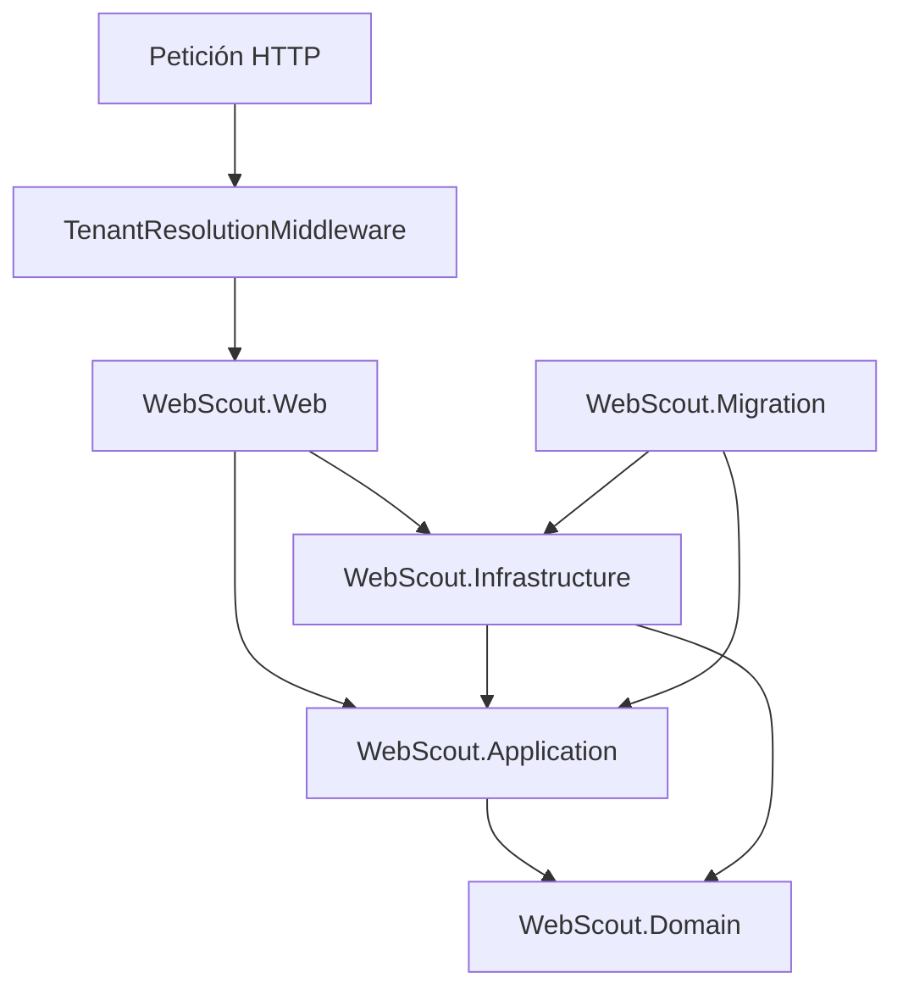

# Arquitectura modular de la web scout multitenant

Versión 1.0 · Refinamiento de arquitectura multitenant SCLM · 8 de noviembre de 2026.

La propuesta es un **monolito modular multitenant en .NET 10 LTS con ASP.NET Core y EF Core**, diseñado para servir a los grupos de Scouts de Castilla-La Mancha (SCLM). La plataforma utiliza una base de datos relacional PostgreSQL con aislamiento lógico mediante filtros globales, almacenamiento particionado por tenant y resolución por subdominio. La interfaz web se construye con Razor Pages o MVC, JavaScript progresivo y un motor dinámico de tematización por tokens CSS.

El Grupo Scout Lestonnac 330 se mantiene como el **grupo piloto** para validar la arquitectura y el proceso de migración de datos.

## Estructura de la solución

Para desacoplar el código de un grupo concreto y permitir la gestión multitenant de SCLM, los proyectos y namespaces adoptan el identificador de plataforma `WebScout`:

```text
WebScout.slnx
src/
  WebScout.Domain/
  WebScout.Application/
  WebScout.Infrastructure/
  WebScout.Web/
tools/
  WebScout.Migration/
tests/
  WebScout.DomainTests/
  WebScout.ArchitectureTests/
  WebScout.IntegrationTests/
  WebScout.WebTests/
docs/
```

- `WebScout.Domain`: Entidades, invariantes de negocio, tipos de valor (como la pañoleta y paleta) y reglas de dominio sin dependencias externas.
- `WebScout.Application`: Casos de uso orquestados, interfaces de servicios, DTOs, políticas de autorización por recurso y resolución del `ITenantContext`.
- `WebScout.Infrastructure`: Persistencia EF Core (`WebScoutDbContext`), repositorios, almacenamiento privado de archivos, motor de plantillas y envío de correo outbox.
- `WebScout.Web`: Middleware de resolución de tenant (`TenantResolutionMiddleware`), páginas Razor, controladores de API, inyección de tokens CSS y componentes visuales.
- `WebScout.Migration`: Herramienta de migración con perfiles de importación por grupo (incluyendo el perfil histórico WordPress de Lestonnac 330) y datos de seed para nuevos grupos de SCLM.

## Dependencias y pipeline de tenant



1. **Resolución de contexto:** `TenantResolutionMiddleware` inspecciona el host/subdominio o la cabecera de desarrollo, localiza la organización en caché y establece el servicio con ámbito `ITenantContext`.
2. **Autorización y contexto resuelto:** Las páginas y controladores nunca reciben `DbContext` directamente. `Application` recibe el contexto verificado del tenant y del usuario autenticado antes de invocar cualquier caso de uso.
3. **Tematización por tenant:** `WebScout.Web` renderiza el layout inyectando las variables CSS del grupo resuelto (`--scout-primary`, `--panoleta-base`, etc.) y sus recursos de identidad.

## Persistencia y aislamiento en EF Core

Se utiliza un único `WebScoutDbContext` para el conjunto de la plataforma con una sola línea de migraciones relacionales:

- **Filtros globales de consulta (Global Query Filters):** Todas las entidades que contienen `OrganizationId` tienen configurado automáticamente un filtro en EF Core para aislar las lecturas al tenant actual:
  `builder.Entity<T>().HasQueryFilter(e => e.OrganizationId == _tenantContext.CurrentTenantId);`
- **Asignación automática en guardado:** El método `SaveChangesAsync` intercepta la creación de entidades y estampa automáticamente el `OrganizationId` del tenant en curso, impidiendo escrituras anónimas o cruzadas.
- **Consultas federativas explícitas:** Las operaciones especiales del equipo de soporte de SCLM deben deshabilitar explícitamente los filtros (`IgnoreQueryFilters()`) bajo un contexto auditado y justificado.

PostgreSQL con Npgsql en .NET 10 LTS es el proveedor de persistencia principal, validado contra el esquema único de la plataforma.

## Comprobaciones de arquitectura

Los tests de arquitectura (`WebScout.ArchitectureTests`) verifican:
- Prohibición de referencias desde Domain hacia Infrastructure o Web.
- Obligatoriedad de `OrganizationId` en todas las entidades de negocio.
- Existencia de filtros globales de consulta en todas las entidades multitenant.
- Prohibición de consultas cruzadas entre organizaciones en los tests de integración con base de datos real.

Las decisiones detalladas se registran en [ADR](decisiones-arquitectura.md).
