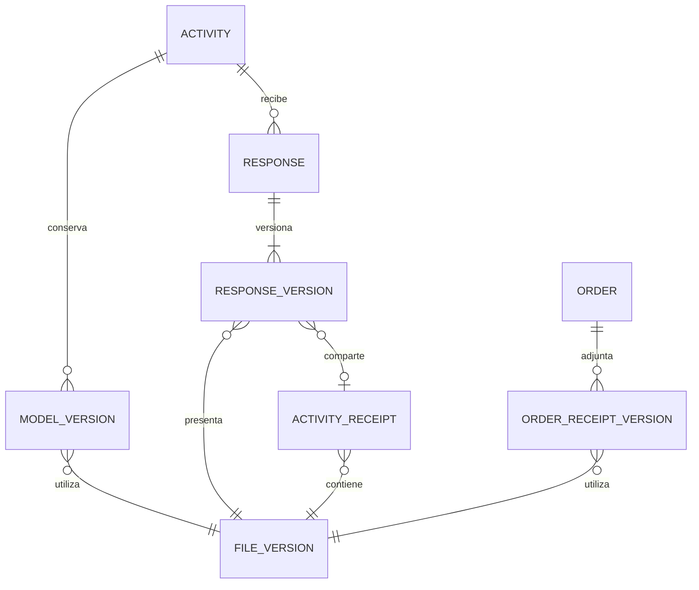

# Modelo de datos y contratos de integridad

Versión 0.1 · Propuesta de arranque · 6 de noviembre de 2026.

El modelo relacional debe hacer explícitas las relaciones que WordPress representa con metadatos e índices de archivo. Los campos utilizados para autorización, filtros y restricciones serán columnas indexadas. Los payloads históricos y bloques editoriales podrán usar JSON con versión de esquema.

## Agregados principales

| Área | Entidades propuestas | Datos esenciales |
| --- | --- | --- |
| Acceso | Organization, OrganizationMembership, UserSection, CapabilityGrant | Estado, perfil, sección, capacidad y versión de seguridad |
| Comunicación | Communication, CommunicationAudience, Comment | Tipo, autor, contenido, estado, audiencia y portada |
| Actividad | Activity, AuthorizationModelVersion | Fechas civiles, plazo, modalidad, céntimos y modelo vigente |
| Entrega | ActivityResponse, ResponseResponsibleSection, ResponseVersion | Titular, participante declarado, estado, modelo, método y documento |
| Pago documental de actividad | ActivityReceipt, ResponseReceiptLink | Actividad, titular, referencia común y versión de archivo |
| Archivos | FileAsset, FileVersion, FileBinding, FileDerivative | Clave opaca, formato verificado, tamaño, hash, propósito y estado |
| Fotos | AlbumFolder, Album, Photo | Jerarquía, audiencia, propietario, publicación y confirmación de subida |
| Pedidos | Product, ProductSize, Order, OrderEvent, OrderReceiptVersion | Instantánea de solicitud, estado, notas, revisión y adjunto |
| Ingreso | JoinRequest, LegacyRegistration, LegacyFormTemplate | Datos mínimos o payload con etiquetas y procedencia |
| Legal y ayuda | LegalDocumentVersion, ConsentEvidence, TourProgress | Texto, elección, vigencia y progreso propio |
| Operación | AuditEvent, Outbox, BackgroundJob, IdempotencyRecord, MigrationRun, LegacyIdMap | Contexto, clave, estado, correlación y reintentos |

## Claves y relaciones

Toda entidad de negocio tiene OrganizationId. Las claves alternativas y foráneas que relacionan recursos de la organización deberán incluirlo. Una respuesta enlaza actividad y titular de la misma organización. Cada vínculo compartido comprobará además ActivityId y OwnerMembershipId; no bastará con una FK al recibo que admita otro titular.

El diagrama muestra relaciones lógicas. El modelo físico distinguirá los vínculos por finalidad y deberá demostrar integridad de cada tipo; no se aceptará una referencia polimórfica ResourceId como garantía suficiente de organización o existencia. Las tablas de respuesta, modelo, foto y pedido tendrán relaciones verificables a sus versiones de archivo.

## Unicidad

- Sección por organización y slug.
- Correspondencia heredada por sistema de origen, tipo e identificador antiguo.
- Idempotencia por organización, actor, operación y clave, con hash de la petición.
- Foto por organización, álbum y token de subida.
- Versión por organización, agregado y ordinal estable.
- Un solo modelo vigente por actividad y un solo adjunto activo de pedido, preservando anteriores.

No habrá una restricción única de respuesta por cuenta y actividad ni por nombre del participante. La prevención de doble envío usa la operación, no el nombre de un hermano.

## Concurrencia y tipos de dato

Los agregados editables tendrán Version como token explícito de EF Core. El proveedor elegido determinará su implementación; no se trasladará un rowversion de SQL Server a PostgreSQL por semejanza de nombre. Los cambios obsoletos fallan con conflicto y no sobrescriben silenciosamente.

Los importes se guardan como céntimos enteros y Currency igual a EUR en el piloto; un precio ausente en histórico se conserva como desconocido y se distingue de cero. El pedido conserva nombre, talla, cantidad, precio y total informativo de la solicitud. No se recalculan a partir del catálogo actual ni se crea un estado de pago activo.

Los instantes de recepción y auditoría se almacenan en UTC. Nacimiento, inicio, final y plazo son fechas civiles; el cierre del plazo usa la zona de la organización. Se prueban días de cambio de horario y límites de cierre. No se aplica una conversión UTC arbitraria a una fecha de nacimiento.

## Archivos y consistencia

FileVersion conserva bytes inmutables y huella SHA256. Las miniaturas son derivadas separadas. En PDF firmado no se eliminan metadatos, se recomprime ni se vuelve a guardar para presentarlo. Una versión anterior no se elimina al sustituirla.

Una preparación privada produce UploadId y estado. Cuando todos los archivos requeridos están validados, el caso de uso asocia las versiones y confirma respuesta o sustitución en base junto a evento y outbox. Si hay comprobación asíncrona, se devuelve operación pendiente y no se presenta una respuesta final como guardada. La versión activa anterior sigue disponible hasta confirmar el reemplazo.

Se conciliará almacenamiento frente a vínculos y preparaciones caducadas. La limpieza física solo alcanza objetos sin referencias que deban conservarse. Borrar una autorización no elimina el justificante de otro hermano. Los detalles de conservación están en [ciclo de vida](politica-ciclo-vida-y-versiones.md).

## Índices iniciales

Organización, estado y fecha en solicitudes y pedidos; organización, actividad, estado y fecha en respuestas; relación de sección responsable; organización, tipo y publicación en comunicaciones; organización, carpeta y estado en álbumes; y organización, recurso y fecha en eventos. Listados y exportaciones usan orden estable y páginas o lotes acotados.

Los datos de salud e identificación de históricos quedan fuera de las proyecciones ordinarias y logs. El modelo no deduce relaciones familiares ni consolida participantes por coincidencia textual. RF26 a RF40, RF49, RF54 y RF68 a RF71 gobiernan estas restricciones.
