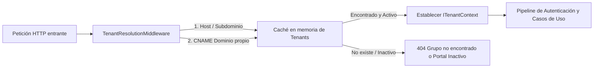
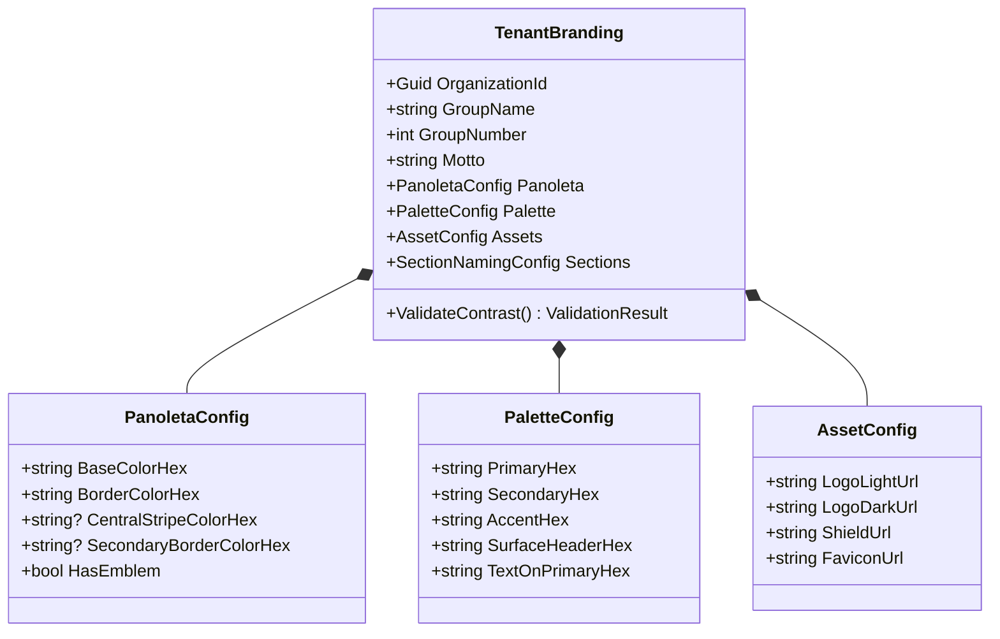
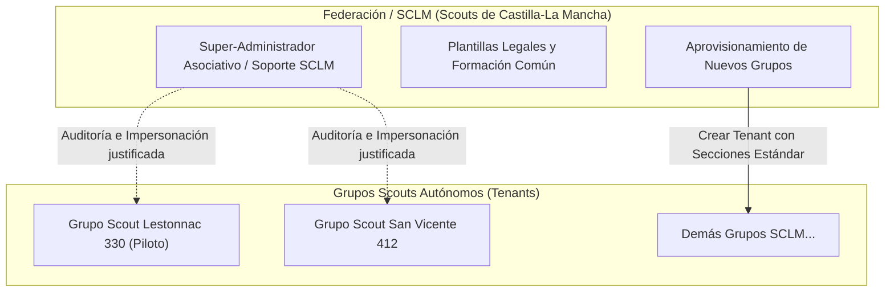

# Análisis y Propuesta: Plataforma Multitenant SCLM con Tematización Grupal

**Versión:** 1.0 · Propuesta de Arquitectura y Refinamiento · 8 de noviembre de 2026  
**Ámbito:** Scouts de Castilla-La Mancha (SCLM) y Grupos Scouts Federados  
**Candidato Piloto:** Grupo Scout Lestonnac 330 (Tenant Piloto)

---

## 1. Resumen Ejecutivo y Diagnóstico de la Documentación Base

La documentación de arranque v0.1 de la Web Scout sentó unas bases sólidas con principios de diseño de alta calidad: monolito modular en .NET 10 LTS, autorización por recurso, persistencia relacional con almacenamiento privado separado, inmutabilidad documental y presencia de `OrganizationId` en todas las entidades de negocio.

Sin embargo, el paquete presentaba un **cuello de botella conceptual**:
1. **Acoplamiento de nomenclatura al grupo piloto:** Uso generalizado del acrónimo `L330` (`L330.slnx`, `L330DbContext`, `L330.*`) en lugar de un nombre de producto asociativo neutro (`WebScout` o `ScoutCLM`).
2. **Postergación artificial del multitenancy:** La decisión `DC01` y el documento `docs/evolucion/vision-multigrupo.md` relegaban el soporte multigrupo a una "investigación posterior al piloto", a pesar de que el modelo de datos ya incorporaba `OrganizationId` en todas sus claves y relaciones.
3. **Ausencia de un motor de tematización e identidad scout:** El requisito `RF62` planteaba una configuración visual básica, pero no definía cómo gestionar la identidad central de un grupo scout: su **pañoleta** (colores de fondo, ribetes y cintas), su escudo, su heráldica, los colores de sus secciones y la garantía de contraste y accesibilidad (WCAG 2.2 AA).
4. **Falta de resolución de tenant y gobernanza federativa:** No se explicitaba el mecanismo de detección de tenant (subdominios `*.scoutsclm.org` o dominios propios) ni la relación entre la asociación regional (SCLM) y los grupos locales autónomos.

### Visión Propuesta
Evolucionar la solución hacia **WebScout SCLM**: una plataforma web multitenant SaaS asociativa donde **cada grupo scout de Castilla-La Mancha dispone de su propio portal de gestión**, con aislamiento estricto de datos de menores y familias, y una experiencia visual completamente personalizada con la identidad, colores y pañoleta de su grupo, manteniendo a Lestonnac 330 como el **primer grupo piloto** de validación y migración.

---

## 2. Arquitectura Multitenant: Modelo de Aislamiento y Resolución

### 2.1. Estrategia de Aislamiento de Datos

Para una red asociativa como SCLM (estimada en 15 a 30 grupos scout con un volumen moderado de usuarios y familias):

| Enfoque | Coste Operativo | Complejidad Migraciones | Aislamiento | Veredicto |
| :--- | :--- | :--- | :--- | :--- |
| **Base de datos por tenant** | Alto (múltiples DBs, costes de hosting elevados) | Alta (ejecutar migraciones N veces) | Físico | Desaconsejado |
| **Esquema por tenant (PostgreSQL)** | Medio (gestión compleja de conexiones) | Media-Alta | Lógico-Físico | Innecesariamente complejo |
| **Base compartida con filtrado lógico estricto (Recomendado)** | **Bajo (un único cluster PostgreSQL administrado)** | **Baja (una única línea de migraciones EF Core)** | **Lógico robusto vía Global Query Filters y RLS** | **ÓPTIMO** |

> [!IMPORTANT]
> **Aislamiento en EF Core 10:**  
> Se utilizarán **Global Query Filters** obligatorios en todas las entidades multitenant:
> ```csharp
> modelBuilder.Entity<Activity>()
>     .HasQueryFilter(e => e.OrganizationId == _tenantContext.CurrentTenantId);
> ```
> Adicionalmente, el `DbContext` interceptará `SaveChangesAsync` para inyectar automáticamente el `OrganizationId` del tenant activo en cualquier entidad nueva, impidiendo escrituras cruzadas accidentales.

### 2.2. Detección y Resolución del Tenant

El contexto del grupo se resolverá en el pipeline de ASP.NET Core mediante un middleware especializado (`TenantResolutionMiddleware`):



1. **Subdominio asociativo (Por defecto):**  
   `https://{slug}.scoutsclm.org` (ej. `lestonnac.scoutsclm.org`, `sanvicente.scoutsclm.org`, `sanignacio.scoutsclm.org`).
2. **Dominio personalizado (Opcional por grupo):**  
   `https://www.scoutslestonnac.es` con registro CNAME apuntando al ingress del cluster.
3. **Entorno local de desarrollo / testing:**  
   `https://{slug}.localhost:5001` o cabecera `X-Tenant-Slug: lestonnac`.

---

## 3. Motor de Tematización e Identidad Scout

La pañoleta scout es el elemento de identidad más representativo de cada grupo. El sistema de diseño debe permitir trasladar con orgullo y rigor scout los colores del grupo a la interfaz web, garantizando a la vez la accesibilidad.



### 3.1. Inyección Dinámica de Tokens CSS (CSS Variables)

El layout del servidor (`_Layout.cshtml`) inyecta en el bloque `<head>` los tokens validados del tenant activo:

```html
<style id="tenant-theme">
  :root {
    --scout-primary: #1b5e20;
    --scout-primary-hover: #144618;
    --scout-primary-contrast: #ffffff;
    --scout-secondary: #fbc02d;
    --scout-secondary-contrast: #212121;
    --scout-accent: #d32f2f;
    
    /* Identidad de Pañoleta */
    --panoleta-base: #1b5e20;
    --panoleta-ribete: #fbc02d;
    --panoleta-cinta: #ffffff;
    
    /* Cabeceras y Superficies */
    --header-bg: #1b5e20;
    --header-text: #ffffff;
    --navbar-active-border: #fbc02d;
  }
</style>
```

### 3.2. Motor de Validación de Accesibilidad (WCAG 2.2 AA)

> [!WARNING]
> La personalización de colores no debe comprometer la legibilidad de las familias ni de los educandos con baja visión o daltonismo.

Al configurar la paleta en el panel de Administración del Grupo:
1. El backend calcula la **luminancia relativa** y el **ratio de contraste** (según algoritmo WCAG 2.2):
   $$\text{Ratio} = \frac{L_1 + 0.05}{L_2 + 0.05}$$
2. Exige un ratio mínimo de **4.5:1** para texto normal y **3:1** para texto grande o componentes de interfaz interactivos.
3. Si un administrador elige un color con contraste insuficiente, el sistema:
   - Ofrece un ajuste inteligente de tono (darken/lighten) para alcanzar el ratio AA automáticamente.
   - Selecciona de forma automática el color del texto superpuesto (`#ffffff` o `#121212`).
4. **Seguridad CSS:** Se prohíbe la subida de archivos CSS o scripts arbitrarios para evitar vectores XSS. La personalización se basa estrictamente en tokens tipados y valores hexadecimales verificados.

### 3.3. Componente de Pañoleta Vectorial SVG

Se incorpora un componente gráfico SVG reutilizable en cabeceras, pie de página, emails y carnet de usuario, que renderiza paramétricamente la pañoleta oficial del grupo a partir de `PanoletaConfig`.

---

## 4. Gobernanza Asociativa: SCLM y Grupos Locales

El modelo organizativo distingue claramente dos niveles de responsabilidad:



1. **Aislamiento absoluto entre grupos:** Un Scouter o Coordinador del Grupo A no tiene visibilidad alguna ni permisos en el Grupo B.
2. **Rol de Soporte Asociativo (SCLM Support):**
   - No tiene acceso indiscriminado a datos de menores ni expedientes médicos/privados.
   - Para intervenciones técnicas o de soporte, se requiere un mecanismo de **acceso delegado con ventana de tiempo** (máximo 4 horas), motivo explícito y registro inmutable en `AuditEvent`.
3. **Cuentas multifamiliares / multi-rol:**
   - Un Scouter de un grupo que a su vez es padre en otro grupo o colaborador asociativo tiene una **única cuenta (`ApplicationUser`)**, pero múltiples `OrganizationMembership`.
   - La interfaz incluye un selector de grupo cuando un usuario tiene membresías activas en más de un tenant.
4. **Aprovisionamiento de nuevos grupos:**
   - La secretaría asociativa de SCLM puede dar de alta un nuevo grupo indicando: nombre, número, localidad, diócesis/provincia, subdominio y correo de coordinación.
   - El aprovisionamiento crea el `OrganizationId` y despliega automáticamente la estructura de ramas/secciones estándar de SCLM (Castores, Manada, Tropa/Scouts, Escultas, Clan) lista para personalizar.

---

## 5. Renombrado y Desacoplamiento de la Solución Técnica

Para evitar que el código quede condicionado a un único grupo, se propone la siguiente transición limpia de namespaces y estructura:

| Estructura v0.1 (Acoplada a L330) | Estructura Refinada v1.0 (Plataforma SCLM) |
| :--- | :--- |
| `L330.slnx` | `WebScout.slnx` (o `ScoutCLM.slnx`) |
| `src/L330.Domain/` | `src/WebScout.Domain/` |
| `src/L330.Application/` | `src/WebScout.Application/` |
| `src/L330.Infrastructure/` | `src/WebScout.Infrastructure/` |
| `src/L330.Web/` | `src/WebScout.Web/` |
| `tools/L330.Migration/` | `tools/WebScout.Migration/` (con perfiles de seed por grupo) |
| `L330DbContext` | `WebScoutDbContext` |

*Nota:* Los datos históricos y scripts de migración de WordPress de Lestonnac 330 se encapsulan en `WebScout.Migration/Profiles/Lestonnac330/` como el primer perfil de importación.

---

## 6. Actualización de Decisiones y Backlog (Impacto en E0 - E5)

1. **Actualización de Decisión DC01:**
   - *Estado anterior:* "Un grupo piloto; claves preparadas".
   - *Nuevo acuerdo:* **"Plataforma multitenant para Scouts de Castilla-La Mancha (SCLM), con arquitectura de base compartida, aislamiento por OrganizationId, tematización dinámica de pañoleta/colores y Lestonnac 330 como grupo piloto de implantación."**
2. **Nuevas Decisiones Técnicas (ADR):**
   - **ADR10:** Resolución de Tenant por Subdominio y Dominio Personalizado en ASP.NET Core.
   - **ADR11:** Motor de Tematización Basado en Tokens CSS Dinámicos y Pañoleta SVG con Validación de Contraste WCAG 2.2 AA.
3. **Evolución del Backlog E0 - E1:**
   - En **E0 (Descubrimiento y Prototipos):** Incluir la prueba de resolución de tenant por subdominio sintético (`grupo1.localhost`, `grupo2.localhost`) e inyección de tokens de color diferentes.
   - En **E1 (Fundación del monolito):** Configurar `TenantResolutionMiddleware`, `ITenantContext`, `GlobalQueryFilters` en EF Core 10 y `TenantBrandingService`.

---

## 7. Conclusión y Próximos Pasos

El planteamiento multitenant con personalización de temática y colores responde plenamente a la realidad del movimiento scout en Castilla-La Mancha: unión en las herramientas y principios, pero absoluto respeto a la identidad visual, colores de pañoleta e independencia organizativa de cada grupo scout.

Esta refinación no añade costes desproporcionados de infraestructura ni retrasa el piloto de Lestonnac 330, ya que aprovecha la arquitectura modular y la clave `OrganizationId` que ya formaban parte del diseño base.
