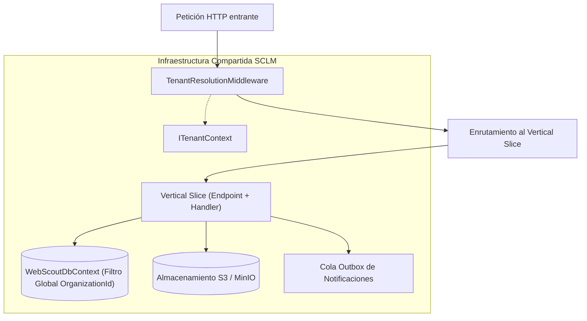

# Arquitectura de la Plataforma Web Scout: Vertical Slice Architecture

Versión 1.1 · Adopción de Vertical Slice Architecture (ADR12) para SCLM · 8 de noviembre de 2026.

La plataforma **WebScout SCLM** es un **monolito modular basado en Vertical Slice Architecture (VSA)** en .NET 10 LTS con ASP.NET Core y Entity Framework Core. En lugar de dividir el código en capas horizontales rígidas (Domain, Application, Infrastructure, Web) que dispersan la lógica de una misma funcionalidad en múltiples proyectos, el sistema organiza el código por **casos de uso o capacidades de negocio verticales** (`Features/`).

La infraestructura transversal (aislamiento multitenant con `OrganizationId`, persistencia relacional con PostgreSQL, almacenamiento privado S3/MinIO y motor de correo Outbox) se centraliza en `Infrastructure/`, garantizando la seguridad y el aislamiento estricto de los datos scouts de forma uniforme para todas las verticales.

---

## Estructura de la Solución

```text
WebScout.slnx
src/
  WebScout.Web/
    Features/                     # 🍕 Casos de uso verticales autocontenidos
      Tenants/                    # Resolución y provisión de grupos scouts
      Branding/                   # Pañoleta, tokens CSS y contraste WCAG 2.2 AA
      Activities/                 # Publicación y gestión de campamentos/actividades
      Inscriptions/               # Inscripciones, consentimientos y justificantes de pago
      Orders/                     # Pedidos de material scout (Core 1.29)
      Gallery/                    # Subida progresiva y galería privada de fotos
      Administration/             # Gestión de miembros, secciones y soporte federativo
    Infrastructure/               # ⚙️ Pilares transversales
      Persistence/                # WebScoutDbContext, Global Query Filters y Migraciones
      Tenancy/                    # TenantResolutionMiddleware y servicio ITenantContext
      Storage/                    # Adaptador S3/MinIO para archivos privados y PDFs
      Outbox/                     # Despacho duradero de correos electrónicos
    Common/                       # 🧩 Modelos compartidos y utilidades matemáticas
      Domain/                     # Entidades base, Value Objects (PanoletaConfig)
      Security/                   # Políticas de autorización por recurso y permisos
      Wcag/                       # Algoritmo de luminancia y contraste WCAG 2.2 AA
tools/
  WebScout.Migration/             # Herramienta de seeds de grupos y migrador WordPress L330
tests/
  WebScout.ArchitectureTests/     # Verificación de aislamiento de slices y multitenancy
  WebScout.IntegrationTests/      # Tests de integración contra PostgreSQL real (PA01-PA19)
  WebScout.WebTests/             # Tests de interfaz y navegación
docs/                             # Documentación viva del proyecto
```

---

## Anatomía de un Vertical Slice

Cada carpeta dentro de `Features/` representa un caso de uso específico y contiene todo lo necesario para responder a la solicitud:

```text
Features/Inscriptions/UploadPaymentReceipt/
├── UploadPaymentReceiptEndpoint.cs   # Endpoint HTTP / Razor Page Handler
├── UploadPaymentReceiptCommand.cs    # Parámetros de entrada del caso de uso
├── UploadPaymentReceiptHandler.cs    # Lógica de negocio y persistencia
├── UploadPaymentReceiptValidator.cs  # Validación (FluentValidation)
└── UploadPaymentReceiptResponse.cs   # Modelo de respuesta / ViewModel
```

### Ventajas para el Proyecto Scout:
1. **Alta cohesión:** Toda la lógica de adjuntar un justificante bancario está en un único lugar.
2. **Cero sobre-ingeniería:** Si una consulta solo la necesita una pantalla, no se crea un repositorio genérico ni interfaces intermedias innecesarias; se consulta directamente vía `WebScoutDbContext`.
3. **Mapeo directo con Requisitos y Pruebas:** Cada slice corresponde a uno o más requisitos del catálogo (`RF01`–`RF71`) y es probado de extremo a extremo mediante las pruebas de aceptación (`PA01`–`PA19`).

---

## Dependencias y Pipeline de Ejecución



1. **Resolución de contexto:** `TenantResolutionMiddleware` detecta el subdominio (`{slug}.scoutsclm.org`), valida la organización activa y expone `ITenantContext`.
2. **Ejecución del Slice:** El handler de la feature recibe `ITenantContext` y `WebScoutDbContext`. Todas las consultas quedan filtradas automáticamente por `OrganizationId`.
3. **Inmutabilidad y Outbox:** Las subidas de archivos van al storage privado (obteniendo clave opaca y hash SHA-256) y los correos se registran en la tabla de Outbox dentro de la misma transacción.

---

## Persistencia y Aislamiento en EF Core

Se utiliza un único `WebScoutDbContext` para el conjunto de la plataforma con una sola línea de migraciones relacionales:

- **Filtros globales de consulta (Global Query Filters):** Todas las entidades que contienen `OrganizationId` tienen configurado automáticamente un filtro en EF Core para aislar las lecturas al tenant actual:
  `builder.Entity<T>().HasQueryFilter(e => e.OrganizationId == _tenantContext.CurrentTenantId);`
- **Asignación automática en guardado:** El método `SaveChangesAsync` intercepta la creación de entidades y estampa automáticamente el `OrganizationId` del tenant en curso, impidiendo escrituras anónimas o cruzadas.
- **Consultas federativas explícitas:** Las operaciones especiales del equipo de soporte de SCLM deben deshabilitar explícitamente los filtros (`IgnoreQueryFilters()`) bajo un contexto auditado y justificado con límite temporal de 4 horas.

---

## Comprobaciones de Arquitectura

Los tests de arquitectura (`WebScout.ArchitectureTests`) verifican:
- **No acoplamiento entre slices:** Un slice de `Features/Activities` no debe depender directamente de los handlers internos de `Features/Orders`. La comunicación entre módulos se realiza mediante eventos o servicios de `Common`.
- **Obligatoriedad de `OrganizationId`:** Toda entidad persistida debe pertenecer a una organización.
- **Aislamiento en tests de integración:** Ninguna consulta ejecutada con el contexto de `lestonnac` puede retornar datos pertenecientes a `sanvicente` (`PA01`, `PA18`).
