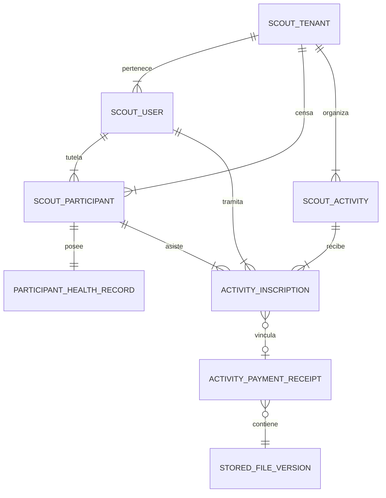

# Modelo de Datos y Contratos de Integridad

**Grupo Scout Lestonnac 330 · Scouts de Castilla-La Mancha (SCLM)**  
Versión 1.1 · Actualización de Arquitectura y Alcance · 8 de noviembre de 2026.

---

## 1. Agregados Principales del Modelo

El modelo relacional traduce los requerimientos funcionales en estructuras tipadas, normalizadas y preparadas para PostgreSQL 17 mediante Entity Framework Core 10. Se sustituyen las estructuras no estructuradas del sistema legado por entidades formales con integridad referencial.

| Área / Agregado | Entidades Principales | Propósito y Contenido Esencial |
| --- | --- | --- |
| **Organización y Tenancy** | `ScoutTenant` | Datos del grupo scout: nombre, slug, colores corporativos, CIF y estado activo. Frontera de seguridad `OrganizationId`. |
| **Identidad y Acceso** | `ScoutUser`, `ScoutRole`, `IdentityUserRole` | Cuentas autenticables vía ASP.NET Core Identity: DNI, nombre completo, rama asignada a scouters (`ScoutBranch`) y roles (`Familia`, `Scouter`, `Coordinacion`, `Administracion`). |
| **Censo de Educandos** | `ScoutParticipant` | Entidad permanente del menor: tutor legal responsable (`LegalGuardianId`), nombre, apellidos, fecha de nacimiento civil, DNI y rama actual (`CurrentBranch`). |
| **Salud y Emergencias** | `ParticipantHealthRecord` | Expediente sanitario anual vinculado 1 a 1 con el educando: CIP/Seguridad Social, alergias alimentarias/medicamentosas, intolerancias, medicación activa pautada, vacunación, natación y teléfonos de emergencia priorizados. |
| **Actividades y Salidas** | `ScoutActivity` | Convocatorias de acampadas y salidas: título, fechas civiles (inicio, fin, fecha límite), ramas destinatarias (máscara de bits o catálogo), cuota en céntimos e instrucciones de transferencia bancaria. |
| **Inscripción y Tramitación** | `ActivityInscription` | Expediente de participación: vincula educando, actividad y tutor; almacena estado (`Borrador`, `PendienteRevision`, `SubsanacionRequerida`, `Confirmada`, `Cancelada`), evidencias legales y nota de subsanación. |
| **Justificantes de Pago** | `ActivityPaymentReceipt` | Documento de transferencia bancaria aportado por la familia. Admite reutilización para múltiples hermanos inscritos a la misma actividad. |
| **Gestión de Archivos** | `StoredFileAsset`, `StoredFileVersion` | Metadatos de archivos físicos (PDFs, imágenes de justificantes): hash SHA-256, tipo MIME verificado, tamaño en bytes y ruta segura fuera de la raíz web pública. |
| **Auditoría y Operación** | `AuditEvent`, `OutboxMessage` | Registro cronológico inmutable de eventos de negocio sensibles y cola transaccional para notificaciones asíncronas por correo. |

---

## 2. Diagrama Entidad-Relación (ERD)

---

## 3. Claves, Restricciones e Invariantes de Integridad

### 3.1. Multitenancy y Claves Foráneas
- **Regla de oro de Tenancy**: Toda entidad operativa posee la columna `OrganizationId NOT NULL` con clave foránea a `ScoutTenants(Id)`.
- Toda relación foránea compuesta valida la consistencia del tenant. Por ejemplo, una `ActivityInscription` no puede vincular una actividad de un grupo con un educando de otro grupo.

### 3.2. Unicidad de Inscripción por Educando
- **Restricción Unique**: `[OrganizationId, ActivityId, ParticipantId]`.
- Un educando solo puede tener un registro de inscripción para una misma actividad. Se elimina el riesgo de envíos duplicados accidentales por parte de las familias.

### 3.3. Pago Compartido para Hermanos
- La entidad `ActivityPaymentReceipt` almacena los metadatos de la transferencia bancaria (titular que ordenó el pago, fecha de la transferencia, referencia bancaria y `FileVersionId`).
- Si una familia inscribe a dos hijos a una misma actividad, ambas entidades `ActivityInscription` apuntan al mismo `PaymentReceiptId`.
- **Integridad**: Un justificante de pago no puede ser reutilizado por cuentas familiares diferentes ni en actividades distintas.

### 3.4. Tipos de Datos y Precisión
- **Importes económicos**: Se almacenan estrictamente como enteros (`int`) que representan **céntimos de euro** (ej. 25,00 € = `2500`). Se evitan por completo errores de redondeo asociados a tipos en coma flotante (`float`/`double`).
- **Fechas de negocio**:
  - `BirthDate` se almacena como `DateOnly` (fecha civil pura, sin zona horaria ni desfases de hora UTC).
  - Fechas de actividad (`StartDate`, `EndDate`) se almacenan como fechas locales de la organización (`Europe/Madrid`).
  - Marcas de tiempo de auditoría y aceptación legal (`ConfirmedAtUtc`, `LegalAcceptedAtUtc`) se registran invariablemente en `DateTime` UTC (`timestamptz` en PostgreSQL).
- **Control de Concurrencia**:
  - Las entidades de negocio editables incorporan una columna de control de versión / token de concurrencia optimista (`xmin` o propiedad de versión en EF Core) para prevenir sobrescrituras simultáneas entre scouters.

---

## 4. Almacenamiento Seguro de Archivos Sanitarios y Justificantes

- Los archivos adjuntos (justificantes de transferencia bancaria, informes médicos excepcionales) no se almacenan como blobs en base de datos ni en carpetas públicas servidas por el servidor web (`wwwroot`).
- Se depositan en un almacenamiento privado de archivos con nombres opacos basados en GUIDs.
- El acceso y descarga de cualquier archivo requiere pasar por un endpoint seguro (`/api/files/{id}`) que comprueba:
  1. Que el usuario autenticado pertenece al mismo `OrganizationId`.
  2. Que el usuario es el tutor legal propietario del expediente O un Scouter con permiso sobre la rama del educando.
- Se calculan y verifican huellas criptográficas **SHA-256** para asegurar la inmutabilidad de los comprobantes presentados.
