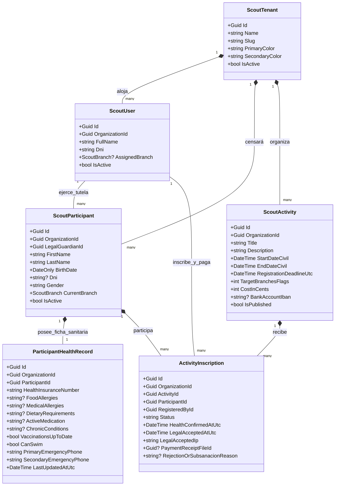

# Modelo Organizativo, Pertenencia y Censo

**Grupo Scout Lestonnac 330 · Scouts de Castilla-La Mancha (SCLM)**  
Versión 1.1 · Actualización de Arquitectura y Alcance · 8 de noviembre de 2026.

---

## 1. Conceptos Fundamentales

La plataforma Web Scout estructura la vida asociativa a través de un modelo organizativo jerárquico y relacional que garantiza el aislamiento de datos entre grupos y la persistencia de los miembros y sus familias:

| Concepto | Definición y Regla en la Plataforma | Entidad en Dominio |
| --- | --- | --- |
| **Organización (Tenant)** | Grupo scout federado en Scouts de Castilla-La Mancha (SCLM). Constituye la frontera estricta de aislamiento lógico de datos y seguridad. | `ScoutTenant` / `OrganizationId` |
| **Identidad Corporativa** | Colores corporativos, configuración de pañoleta (fondo, ribete, cinta), escudo y datos jurídicos del grupo (CIF, sede). | Propiedades de configuración en Tenant |
| **Cuenta de Usuario** | Persona física autenticada en el sistema mediante ASP.NET Core Identity. Dispone de credenciales, roles y pertenencia a un grupo scout. | `ScoutUser` (`IdentityUser<Guid>`) |
| **Roles de Pertenencia** | Perfiles funcionales dentro del grupo: `Familia` (tutores legales), `Scouter` (educadores scouts), `Coordinacion` (jefatura de grupo) y `Administracion`. | `ScoutRoles` / `ScoutRole` |
| **Rama o Sección** | Unidades pedagógicas por grupos de edad: `Castores` (6-8 años), `Manada` (8-11), `Tropa` (11-14), `Escultas` (14-17) y `Clan` (17-21). | `ScoutBranch` (Enum y catálogo de sección) |
| **Educando (Menor)** | Miembro juvenil activo del grupo scout. Es una **entidad permanente**, vinculada a su tutor legal (`ScoutUser`) y asignada a una rama específica. | `ScoutParticipant` |
| **Ficha Médica Anual** | Expediente sanitario y clínico del educando: alergias, intolerancias, medicación activa, CIP de salud, natación y teléfonos de emergencia. | `ParticipantHealthRecord` |
| **Inscripción a Actividad** | Registro formal de participación de un educando en un campamento o salida; consolida la validación sanitaria, la autorización legal y el pago. | `ActivityInscription` |

---

## 2. Diagrama de Relaciones Organizativas

---

## 3. Invariantes del Modelo de Negocio

1. **Aislamiento Multitenant Inquebrantable**:
   - Todas las entidades del dominio implementan `ITenantScopedEntity` (`OrganizationId`).
   - Las consultas en base de datos están protegidas por *Global Query Filters* en Entity Framework Core.
   - Un usuario jamás puede ver ni interactuar con educandos, inscripciones o actividades pertenecientes a otro grupo scout federado.
2. **Pertenencia Familiar y Tutela Legal**:
   - Un `ScoutParticipant` (educando) pertenece inequívocamente al tutor legal (`ScoutUser` con rol `Familia`) que ostenta su patria potestad o tutela.
   - Solo el tutor legal acreditado (o la Coordinación / Secretaría del grupo en casos excepcionales) puede actualizar los datos personales y la Ficha Médica del menor.
3. **Persistencia y Ciclo de Vida del Educando**:
   - El educando no es un conjunto de cadenas de texto efímero en un formulario. Su expediente perdura a lo largo de las rondas solares.
   - Cuando un menor cumple la edad de paso de rama (ej. de Manada a Tropa), se actualiza su `CurrentBranch` conservando todo su histórico médico y de salidas previas.
4. **Segmentación del Kraal por Rama**:
   - Un Scouter asignado a una rama (ej. `AssignedBranch = ScoutBranch.Manada`) tiene acceso de lectura y revisión circunscrito a los educandos e inscripciones de dicha rama.
   - La visualización de actividades generales de grupo no otorga a un scouter de Manada acceso a las inscripciones o fichas sanitarias de educandos de Tropa o Escultas.
5. **Autonomía de Hermanos y Pago Compartido**:
   - En una unidad familiar con múltiples hermanos, cada menor dispone de su propio registro `ActivityInscription` con su estado de tramitación independiente.
   - Si la familia realiza un pago agrupado por transferencia, el identificador del archivo justificante (`PaymentReceiptFileId`) puede ser compartido por ambas inscripciones sin duplicidad de almacenamiento y sin acoplar los estados de revisión.

---

## 4. Evolución y Decisiones Futuras

- **Paso al Kraal (Mayoría de Edad)**: Cuando un educando del Clan cumple 18 años o pasa a colaborar como educador scout, se contempla un proceso guiado de promoción de su entidad a cuenta propia de `ScoutUser` con rol `Scouter`.
- **Rondas Solares y Pasos de Rama Masivos**: Herramienta administrativa para realizar la transición de rama de los educandos al inicio de cada curso scout (octubre).
- **Censo Regional Federativo (SCLM)**: Integración futura con el censo autonómico de la federación mediante API segura, manteniendo a Lestonnac 330 como fuente fidedigna del día a día.
