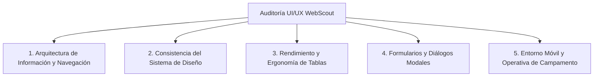

# 🧭 Auditoría Técnica de UI/UX · WebScout SCLM
**Fecha:** Noviembre 2026 · **Evaluador:** Experto en Diseño de Producto, Design Systems y Arquitectura Frontend .NET / Blazor

---

## 1. Diagnóstico Ejecutivo
La plataforma **WebScout SCLM** posee una base técnica sólida: adopta *Vertical Slice Architecture*, separación limpia por roles (`Familia`, `Scouter`, `Coordinación`, `Administración`), paleta accesible bajo WCAG 2.2 AA (mínimo 4.5:1) y componentes MudBlazor modernos.

Sin embargo, tras el crecimiento funcional de los bloques (Censo, Actividades, Inscripciones, Dossier, Admisiones, Administración y Pedidos de Material), se observan **disparidades de coherencia visual, patrones de interacción divergentes y oportunidades críticas de ergonomía**, especialmente para usuarios en entornos reales (familias en móviles y scouters al aire libre en campamentos).

---

## 2. Hallazgos Técnicos y Áreas de Mejora

---

### Dimensión 1: Arquitectura de Información y Navegación (Wayfinding)

#### 🔴 Hallazgo 1.1: Ausencia de Migas de Pan (Breadcrumbs) y Contexto Profundo
- **Problema:** En páginas de segundo y tercer nivel (ej. `/kraal/actividades/detalles`, `/administracion/outbox`, modales de dossier), el usuario pierde noción de su nivel jerárquico. Solo depende del botón "Atrás" del navegador.
- **Impacto UX:** Desorientación en flujos administrativos largos.
- **Mejora Propuesta:** Incorporar componente unificado `<ScoutBreadcrumbs>` en la cabecera de todas las vistas secundarias con retorno directo al hub principal.

#### 🟡 Hallazgo 1.2: El "Scouter-Padre" (Doble Rol en la Asociación)
- **Problema:** En el mundo scout es muy habitual que un scouter del Kraal sea a su vez padre/madre de un castor o lobato. Actualmente, el menú lateral muestra tanto "Portal Familias" como "Gestión Kraal" en un listado plano que genera confusión de contexto (ej. ¿estoy viendo las inscripciones de mi hijo o las que debo aprobar como monitor?).
- **Mejora Propuesta:** Selector rápido de modo o pestañas superiores en el Drawer: `[Modo Familiar]` | `[Modo Scouter / Kraal]`.

---

### Dimensión 2: Coherencia del Sistema de Diseño (Design Tokens & Componentes)

#### 🔴 Hallazgo 2.1: Disparidad de Empty States (Estados Vacíos)
- **Problema:** Hasta la corrección actual, cada página resolvía el estado vacío a su manera:
  - En Admisiones: un `
`
  - En Inscripciones: un `<MudPaper Class="pa-8 text-center">`
  - En Material: un div simple que quedaba desalineado a la izquierda por falta de flex centering.
- **Mejora Propuesta:** Componente estándar reutilizable `<ScoutEmptyState>` o uso del slot nativo `<NoRecordsContent>` de `MudTable` con contenedor centrado, icono en fondo circular pastel (`#F8FAFC`), texto claro y botón de acción directa si hay filtros activos.

#### 🟡 Hallazgo 2.2: Heterogeneidad en Insignias y Chips de Estado
- **Problema:** Existen 4 máquinas de estados distintas en la aplicación (`EstadoActividad`, `EstadoInscripcion`, `EstadoSolicitudAdmision`, `EstadoPedidoMaterial`). Cada página define su propio método `ObtenerColorEstado` local en `@code`, provocando que un estado informativo en una pantalla use `Color.Info` y en otra `Color.Primary`.
- **Mejora Propuesta:** Unificar un componente `<ScoutStatusBadge Estado="..." />` o un helper estático centralizado `ScoutBadgeStyles` que garantice que "Revisado" siempre sea ámbar suave, "Entregado" verde éxito y "En Proveedor" púrpura corporativo.

---

### Dimensión 3: Rendimiento y Ergonomía de Tablas (Data Tables UX)

#### 🔴 Hallazgo 3.1: Falta de Paginación y Virtualización en Tablas Masivas
- **Problema:** Las tablas de Censo de Educandos, Inscripciones y Pedidos cargan todos los registros directamente en el DOM de Blazor Server. En grupos con más de 120 educandos o tras acumular pedidos de ronda solar, el árbol de componentes sufrirá degradación de rendimiento.
- **Mejora Propuesta:** Activar paginación nativa con selector de filas (`RowsPerPage="25"`, `RowsPerPageOptions="new[] { 10, 25, 50, 100 }"`) o `Virtualize="true"` en `MudTable`.

#### 🟢 Hallazgo 3.2: Cabecera Fija (Sticky Header) en Scroll Vertical
- **Problema:** Al revisar tablas de más de 20 filas en pantallas de ordenador, al hacer scroll hacia abajo se pierde de vista el encabezado de las columnas, dificultando saber qué columna corresponde a importes, comprobantes o acciones.
- **Mejora Propuesta:** Añadir `FixedHeader="true"` y `Height="calc(100vh - 380px)"` en las tablas principales del Kraal.

---

### Dimensión 4: Formularios y Diálogos Modales

#### 🟡 Hallazgo 4.1: Diálogos con Acciones no Fijas (Scroll Offscreen)
- **Problema:** En modales con formularios extensos (ej. Ficha Médica o Edición de Actividad con punto de encuentro, precios y fechas), si el usuario tiene una pantalla de resolución reducida (1366x768 o tablet), los botones de "Guardar" y "Cancelar" quedan fuera de la vista inferior, obligando a hacer scroll dentro del modal para encontrar el botón de confirmación.
- **Mejora Propuesta:** Aplicar en `MudDialog`:
  - `ContentStyle="max-height: 70vh; overflow-y: auto;"`
  - Mantener `DialogActions` en posición fija en la parte inferior del diálogo.

#### 🟢 Hallazgo 4.2: Feedback de Carga Inmediato en Botones de Envío
- **Problema:** Al pulsar botones de acción crítica (ej. "Confirmar Pedido", "Convertir en Educando", "Despachar Cola"), el botón permanece habilitado durante 200-500ms mientras se completa la tarea asíncrona, arriesgando dobles clics involuntarios.
- **Mejora Propuesta:** Añadir patrón estándar en botones de diálogo con estado `_procesando` y `MudProgressCircular` embebido.

---

### Dimensión 5: Experiencia Móvil y Operativa en Campamento

#### 🔴 Hallazgo 5.1: Densidad de Tablas en Smartphones
- **Problema:** En pantallas móviles (< 600px), las tablas de 8 columnas del Kraal dependen del modo de apilado responsivo de MudBlazor (`DataLabel`), lo que alarga excesivamente la página hacia abajo convirtiendo una lista de 15 pedidos en un scroll kilométrico.
- **Mejora Propuesta:** 
  - En escritorio: Tabla completa con todas las columnas.
  - En móvil (`sm` y `xs`): Vista alternativa basada en tarjetas compactas (`ScoutOrderCard` / `ScoutParticipantCard`) con acciones directas mediante botón de opciones contextuales (tres puntos `⋮`).

#### 🟢 Hallazgo 5.2: Targets Táctiles (Tap Targets) en Listados de Asistencia
- **Problema:** Los botones de check-in rápido (Salida / Regreso) en el dossier de campamento miden actualmente ~32px de alto. Bajo luz solar directa y con prisa en la subida a un autobús, el dedo puede pulsar la fila errónea.
- **Mejora Propuesta:** Garantizar objetivos táctiles mínimos de **44x44 px** (WCAG 2.5.5 Target Size) para todos los botones de campo.

---

## 3. Matriz de Prioridades de Implementación

| ID | Mejora Propuesta | Impacto UX | Esfuerzo Técnico | Estado |
| :--- | :--- | :---: | :---: | :---: |
| **M1** | Utilidades CSS globales y centrado nativo de `EmptyState` en tablas | Alto | Muy Bajo | **✅ Resuelto (Paso 14.1)** |
| **M2** | Paginación y `FixedHeader` en tablas de Kraal y Familias | Alto | Bajo | **P1 (Recomendado)** |
| **M3** | Pestañas de cambio de contexto Scouter / Familiar | Medio | Medio | **P1** |
| **M4** | Adaptación de tablas a tarjetas compactas en vista móvil | Muy Alto | Medio | **P2** |
| **M5** | Centralización de badges de estado con variantes pastel uniformes | Medio | Bajo | **P2** |
| **M6** | Migas de pan y bloqueo contra doble clic en formularios modales | Medio | Bajo | **P3** |
