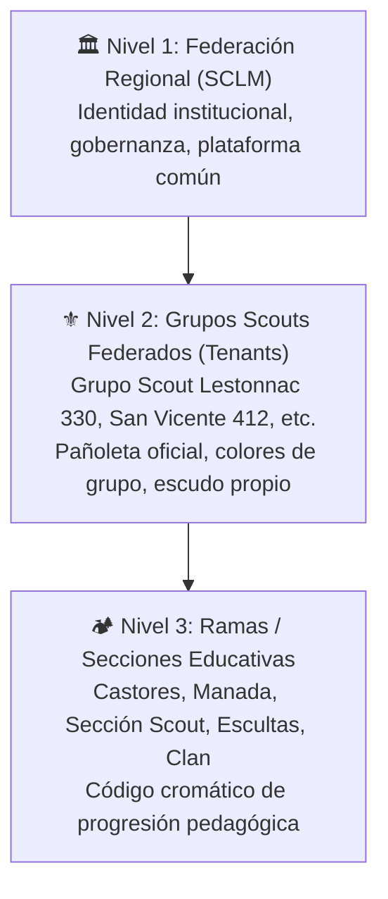
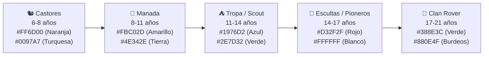

# Manual de Identidad Corporativa y Guía de Estilo Visual

**WebScout SCLM · Scouts de Castilla-La Mancha**  
*Versión 0.1 · Documento vivo de diseño y comunicación · Noviembre de 2026.*

---

## 1. Propósito y Filosofía de Marca

El presente **Manual de Identidad Corporativa y Guía de Estilo** define las normas visuales, técnicas y de tono de comunicación para la plataforma **WebScout SCLM**, así como para las interfaces web y comunicaciones oficiales de los grupos scouts federados.

Este manual es un **documento evolutivo y vivo**: establece los cimientos indispensables en la fase de arranque (MVP / Piloto) y está estructurado para incorporar progresivamente nuevos elementos (patrones visuales avanzados, guías de fotografía, carcelería, merchandising y plantillas de correo).

### Principios Fundacionales de Diseño

1. **Naturaleza, Simplicidad y Servicio:**
   La estética scout refleja sobriedad, aventura, cercanía comunitaria y orden. Se evitan elementos recargados, florituras innecesarias o interfaces confusas.
2. **Prioridad Móvil y Realidad Familiar:**
   Las familias y los scouters interactúan frecuentemente con la plataforma desde teléfonos móviles, a menudo en movimiento, con mala iluminación o conectividad intermitente de campamento. La legibilidad y la facilidad de acción priman sobre la ornamentación.
3. **Inclusión y Accesibilidad Universal (WCAG 2.2 AA):**
   La pertenencia scout no excluye a nadie. La interfaz garantiza por contrato de diseño una navegación óptima para personas con baja visión, daltonismo, movilidad reducida o diversidad cognitiva.
4. **Respeto a la Identidad Federal y Local (Multitenant):**
   Existe una identidad paraguas regional (**SCLM**) que convive armoniosamente con la identidad histórica, colores de pañoleta y heráldica tradicional de cada grupo local (**Tenant**).

---

## 2. Arquitectura de Marca (Modelo Federado)

La identidad gráfica opera en tres niveles jerárquicos complementarios:



* **Nivel 1 (SCLM):** Marca la estructura, el chasis de la aplicación, el cumplimiento normativo (RGPD, accesibilidad) y la paleta institucional federativa.
* **Nivel 2 (Grupo Local):** Define la personalización del portal (`{slug}.scoutsclm.org`), la cabecera, los colores de acción primarios/secundarios y el renderizado de la pañoleta oficial.
* **Nivel 3 (Secciones):** Proporciona un código de color unificado y transversal que ayuda a educandos y familias a ubicar instantáneamente la rama a la que pertenece cada actividad o aviso.

---

## 3. Simbología y Elementos Gráficos Nucleares

### 3.1. La Flor de Lis Scout
* La Flor de Lis mundial y la Flor de Lis de SCLM representan el compromiso, los tres principios y las tres virtudes scouts.
* **Uso digital:** Se utiliza como isotipo en favicon, cabeceras institucionales, marcas de agua suaves y pines de navegación.
* **Área de protección:** Debe preservarse un margen mínimo equivalente al 25% de la anchura del símbolo libre de otros elementos gráficos o tipográficos.

### 3.2. La Pañoleta Scout (Eje Nuclear de Identidad)
La pañoleta es el símbolo universal de pertenencia a un grupo scout. En WebScout SCLM se representa mediante un **componente paramétrico vectorial SVG** limpio y escalable, eliminando el uso de imágenes rasterizadas de baja calidad.

#### Anatomía y Geometría Vectorial
* **Forma:** Triángulo isósceles con base superior y vértice inferior apuntando hacia abajo (proporción base-altura recomendada: 100 x 75 unidades de vista SVG).
* **Variantes de diseño reconocidas:**
  1. **Lisa / Color plano:** Un único paño cromático.
  2. **Ribete exterior (borde simple):** Franja perimetral de 6 a 8 unidades que rodea el triángulo.
  3. **Doble ribete:** Dos franjas concéntricas en el perímetro exterior.
  4. **Cinta central:** Línea divisoria vertical desde el centro de la base hasta el vértice.
  5. **Bicolor partido:** Mitad izquierda de un color y mitad derecha de otro.
  6. **Escudo bordado:** Inserción del emblema del grupo en el vértice o en el centro.

```text
    ┌─────────────────────────── Base Superior ───────────────────────────┐
    │                                                                     │
    ▼                                                                     ▼
    (0,0) ═════════════════════════════════════════════════════════════ (100,0)
     ╲                                                                 ╱
      ╲                               │                               ╱
       ╲                         Cinta Central                       ╱
        ╲                             │                             ╱
    Ribete Perimetral                 │                  Ribete Perimetral
          ╲                           ▼                           ╱
           ╲                       [Escudo]                      ╱
            ╲                         │                         ╱
             ╲                        │                        ╱
              ╲                       │                       ╱
               ╲                      │                      ╱
                ══════════════════ (50,75) ═════════════════
                                      ▲
                                      │
                               Vértice Inferior
```

### 3.3. Logotipos y Heráldica de Grupo
* **Formatos autorizados:** SVG (vectorial preferente) o WebP / PNG con canal alfa (fondo transparente) y resolución mínima de 512x512 px.
* **Seguridad:** Los archivos son validados en el backend mediante inspección de cabeceras MIME y no se permite la ejecución de scripts embebidos en archivos SVG (`<script>` o manejadores `onload`).

---

## 4. Sistema Cromático y Tokens de Diseño

### 4.1. Paleta Institucional SCLM
La identidad regional utiliza como base el púrpura scout mundial combinado con tonos de apoyo inspirados en la tierra castellano-manchega:

| Uso | Nombre | Hexadecimal | Muestra | Contraste sobre Blanco |
| --- | --- | --- | --- | --- |
| Marca Principal SCLM | Scout Purple | `#4A148C` |  | 11.2:1 (AAA) |
| Acento / Calidez | Almagro Terracotta | `#C25E00` |  | 4.8:1 (AA) |
| Superficie Clara | Off White Canvas | `#F8FAFC` |  | - |
| Carbón Textos | Dark Charcoal | `#0F172A` |  | 16.1:1 (AAA) |

### 4.2. Código Cromático Oficial de Secciones Pedagógicas
Para mantener la coherencia asociativa en todos los grupos de la federación, las ramas educativas comparten un código visual uniforme:



### 4.3. Tokens CSS Dinámicos (`:root`) por Tenant
La plataforma no permite inyección de CSS arbitrario. La identidad de cada grupo se materializa inyectando variables estándar en el elemento `:root`:

```css
:root {
  /* ========================================================
     1. Colores de Marca y Acción del Tenant
     ======================================================== */
  --scout-primary: #1B5E20;          /* Color principal (botones primarios, cabeceras) */
  --scout-primary-hover: #144618;    /* Estado hover / focus */
  --scout-primary-contrast: #FFFFFF; /* Color de texto calculado (blanco o carbón) */
  --scout-secondary: #FBC02D;        /* Color complementario y badges de realce */
  --scout-secondary-contrast: #212121;
  --scout-accent: #D32F2F;           /* Avisos, plazos vencidos y peligro */

  /* ========================================================
     2. Identidad de Pañoleta (Renderizado SVG y Bordes)
     ======================================================== */
  --panoleta-base: #1B5E20;
  --panoleta-ribete: #FBC02D;
  --panoleta-cinta: #FFFFFF;

  /* ========================================================
     3. Superficies, Fondos y Bordes Neutros
     ======================================================== */
  --scout-bg-page: #F8FAFC;
  --scout-bg-card: #FFFFFF;
  --scout-text-main: #0F172A;
  --scout-text-muted: #64748B;
  --scout-border-subtle: #E2E8F0;
  --scout-border-strong: #CBD5E1;

  /* ========================================================
     4. Estados Semánticos Accesibles
     ======================================================== */
  --scout-state-success: #15803D;    /* Confirmado / Verificado */
  --scout-state-warning: #B45309;    /* Pendiente de pago / En revisión */
  --scout-state-danger: #B91C1C;     /* Requiere subsanación / Plazo vencido */
  --scout-state-info: #0369A1;       /* Informativo / Noticia */
}
```

### 4.4. Regla Algorítmica de Accesibilidad (WCAG 2.2 AA)
Cualquier color de fondo interactivo o de texto debe pasar la prueba del motor de contraste en el servidor (`WcagContrastCalculator.cs`):
$$\text{Ratio} = \frac{L_1 + 0.05}{L_2 + 0.05} \ge 4.5:1 \quad (\text{o } \ge 3:1 \text{ para controles y texto grande})$$
* **Regla de salvaguarda:** Si un administrador selecciona un color de fondo con contraste deficiente, el sistema selecciona automáticamente entre `#FFFFFF` o `#0F172A` para garantizar legibilidad, ofreciendo además una sugerencia de aclarado o ensombrecimiento del fondo.

---

## 5. Tipografía y Jerarquía Visual

### 5.1. Pila Tipográfica del Sistema (*System Font Stack*)
Para maximizar la velocidad móvil (LCP < 2.5s) y garantizar legibilidad sin dependencia de redes externas en salidas y acampadas, se utiliza la pila de fuentes del sistema operativo:

```css
font-family: -apple-system, BlinkMacSystemFont, "Segoe UI", Roboto, Helvetica, Arial, sans-serif, "Apple Color Emoji", "Segoe UI Emoji";
```

* **Ventajas:** Descarga 0 KB, carga instantánea (0 ms FOUT/FOIT), renderizado optimizado por la GPU del dispositivo nativo.

### 5.2. Escala Modular y Espaciado

| Nivel | Tamaño (rem / px) | Peso (weight) | Interlineado (line-height) | Uso Principal |
| --- | --- | --- | --- | --- |
| **H1** | `2.25rem` (36px) | 700 (Bold) | 1.2 | Título de página / Nombre del Grupo |
| **H2** | `1.75rem` (28px) | 700 (Bold) | 1.25 | Secciones principales / Mi Espacio |
| **H3** | `1.35rem` (21.6px) | 600 (SemiBold) | 1.3 | Títulos de tarjetas / Bloques de trámite |
| **Body** | `1.00rem` (16px) | 400 (Regular) | 1.5 | Texto principal, lectura cómoda |
| **Small / Badge**| `0.85rem` (13.6px) | 600 (SemiBold) | 1.4 | Estados, metadatos, fechas, censo |
| **Code / Hash** | `0.875rem` (14px) | 400 (Regular) | 1.4 | Identificadores de trámite, hashes |

---

## 6. Componentes de Interfaz (UI Kit)

### 6.1. Botones y Objetivos Táctiles
* **Tamaño mínimo táctil:** $\ge 44 \times 44 \text{ px}$ de área interactiva efectiva (conforme a WCAG 2.2 Success Criterion 2.5.8 *Target Size*).
* **Foco visible:** Indicador perimetral de foco de teclado evidente (`outline: 2px solid var(--scout-secondary); outline-offset: 2px`).
* **Jerarquía de botones:**
  * **Primario:** Fondo `var(--scout-primary)`, texto contrastado. Solo una acción principal por pantalla ("Presentar autorización", "Confirmar pedido").
  * **Secundario:** Fondo neutro con borde `var(--scout-border-strong)`, texto `var(--scout-text-main)` ("Volver", "Descargar borrador").
  * **Peligro / Destructivo:** Fondo `var(--scout-state-danger)`, texto blanco ("Cancelar inscripción", "Eliminar borrador").
  * **Subsanación:** Borde ámbar con icono evidente ("Corregir datos del participante").

### 6.2. Tarjetas de Participante (Área Familiar)
* Contenedor blanco con borde suave de 1px (`--scout-border-subtle`) y radio de curvatura de `12px`.
* Cabecera de tarjeta con la insignia de la rama (Castor, Lobo, etc.) y nombre completo del educando.
* Lista de trámites activos asociados exclusivamente a dicho educando.

### 6.3. Insignias de Estado (Badges Semánticos)
No se confía únicamente en el color para transmitir el estado (accesibilidad para daltonismo): siempre se acompaña de texto descriptivo y de un icono o símbolo claro:

* `[✓ Confirmado]` Fondo verde tenue, texto `--scout-state-success`.
* `[⏳ Pendiente]` Fondo ámbar tenue, texto `--scout-state-warning`.
* `[⚠️ Requiere Corrección]` Fondo rojo tenue, texto `--scout-state-danger`.
* `[🔒 Cerrado / Archivado]` Fondo gris neutro, texto `--scout-text-muted`.

---

## 7. Tono de Voz y Redacción (UX Writing)

El lenguaje de la aplicación representa el espíritu educativo scout: **cercano, transparente, riguroso y empático**.

### Pautas de Redacción:
1. **Claridad sobre tecnicismos:** En lugar de *"El registro de la entidad ha fallado debido a un conflicto de clave foránea"*, escribir: *"No hemos podido guardar la inscripción porque este participante ya está inscrito en la actividad."*
2. **Terminología Scout Auténtica:** Usar siempre los términos consagrados en el [glosario oficial](../glosario.md):
   * *Scouter* (nunca "monitor" ni "profesor").
   * *Educando / Participante* (según el contexto de la ficha o autorización).
   * *Kraal* (para el equipo de scouters del grupo).
   * *Ronda Solar* (para el curso scout anual, ej. 2026/2027).
   * *Rama / Sección* (Castores, Manada, Tropa/Scouts, Escultas/Pioneros, Clan/Rutas).
3. **Trámites y Dinero sin ambigüedad:**
   * Distinguir siempre *"Justificante recibido (pendiente de revisión)"* de *"Pago confirmado por tesorería"*.
   * Explicar claramente si un importe cubre transporte, pensión completa o material de campamento.

---

## 8. Hoja de Ruta del Manual (Secciones a Rellenar Poco a Poco)

Este manual se ampliará en las siguientes iteraciones a medida que avance el desarrollo de los módulos:

- [ ] **Fase 1 (Próxima):** Guía de Iconografía Scout Vectorial (símbolos SVG para acampada, mochila, botiquín, senderismo, tienda de campaña).
- [ ] **Fase 2:** Protocolo Ético y Guía de Fotografía de Menores (encuadres, desenfoques de protección, consentimiento de publicación en galería pública vs privada).
- [ ] **Fase 3:** Sistema de Plantillas de Correo Transaccional (notificaciones de aviso de campamento, confirmación de plaza, aviso de cuota).
- [ ] **Fase 4:** Carnet Digital Scout y Credenciales (diseño de carnet en pantalla e imprimible para salidas).
- [ ] **Fase 5:** Guía de Merchandising y Uniformidad (estandartes, sudaderas, polos de kraal y pañoletas de tela).

---

*Documento aprobado para la línea base de diseño de WebScout SCLM. Cualquier ampliación o modificación de tokens debe respetar los umbrales de accesibilidad WCAG 2.2 AA.*