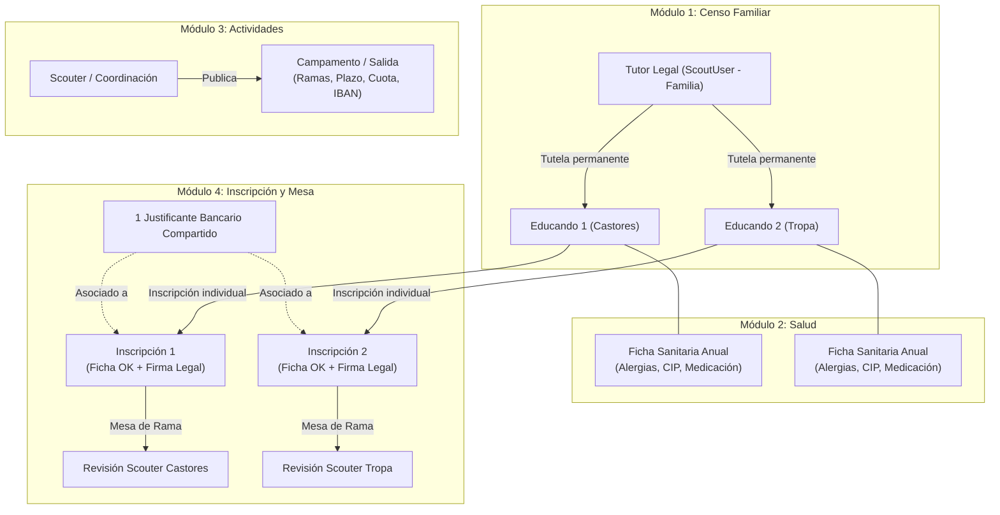

# Definición del MVP y Alcance Operativo del Piloto

**Grupo Scout Lestonnac 330 · Scouts de Castilla-La Mancha (SCLM)**  
Versión 1.0 · 8 de noviembre de 2026.

---

## 1. Propósito y Enfoque

El presente documento define con rigor el **alcance, arquitectura funcional y límites operativos del Producto Mínimo Viable (MVP)** de la plataforma Web Scout para su puesta en marcha piloto con el **Grupo Scout Lestonnac 330**.

### Superación del modelo anterior
En la solución técnica anterior de Lestonnac 330, las actividades se gestionaban mediante formularios web planos y desarticulados:
- Cada actividad obligaba a los tutores a reintroducir datos personales, teléfonos y alergias de sus hijos una y otra vez («participante declarado» efímero).
- Las fichas médicas se gestionaban como PDFs sueltos subidos a cada evento, provocando desactualización clínica, duplicidad y riesgo de omisión de alergias críticas.
- Los scouters de cada rama debían cribar manualmente hojas de cálculo gigantes para separar a los niños de su sección y extraer la información para la cocina del campamento.

El MVP de Web Scout erradica esta deuda estructural introduciendo un **modelo relacional persistente, centrado en el educando y en la unidad familiar**, con aislamiento estricto por organización (*multitenancy*).

---

## 2. Los 4 Módulos Esenciales del MVP

---

### Módulo 1: Censo de Familias y Educandos
Estructura la base duradera de personas dentro del grupo scout:
1. **Cuenta Familiar (`ScoutUser` con rol `Familia`)**:
   - Representa al padre, madre o tutor legal acreditado.
   - Vinculación permanente con su organización (`OrganizationId = Lestonnac 330`).
   - Gestión de datos de contacto principales (teléfono, email, DNI/NIE).
2. **Educandos Registrados (`ScoutParticipant`)**:
   - Cada menor es un registro permanente dependiente de su tutor legal.
   - Atributos esenciales: Nombre de pila, Apellidos, Fecha de nacimiento civil, Sexo, DNI/NIE (opcional según franja de edad).
   - **Rama Asignada (`ScoutBranch`)**: `Castores` (6-8 años), `Manada` (8-11 años), `Tropa` (11-14 años), `Escultas` (14-17 años) o `Clan` (17-21 años).
   - Estado del educando: `Activo` en la ronda solar o `Baja/Histórico`.

---

### Módulo 2: Ficha Médica y Sanitaria Anual
Garantiza que la información clínica y de emergencia esté siempre centralizada, estructurada y disponible:
1. **Expediente Sanitario Anual (`ParticipantHealthRecord`)**:
   - Cumplimentado de forma comprensiva al inicio de la ronda solar y editable en cualquier momento por el tutor legal.
   - **Identificación sanitaria**: Nº de Seguridad Social / CIP, Aseguradora (si aplica).
   - **Alergias e Intolerancias (Crítico para Campamentos)**:
     - Alergias alimentarias (frutos secos, legumbres, huevo, marisco, etc.).
     - Alergias medicamentosas (penicilina, AINEs, etc.).
     - Alergias ambientales y picaduras (avispas, polen, ácaros).
     - Intolerancias y régimen dietético (celiaquía, intolerancia a la lactosa, vegetariano/vegano, exclusión religiosa).
   - **Tratamientos y Patologías**:
     - Medicación activa y pautas exactas de administración durante salidas.
     - Enfermedades crónicas relevantes (asma, diabetes, epilepsia, cardiopatías).
     - Estado de vacunación según calendario oficial (declaración responsable de vacunación al día).
   - **Capacidades operativas en actividades**:
     - Nivel de natación (*«¿Sabe nadar?»* — indispensable para campamentos de verano y actividades acuáticas).
   - **Contactos de Emergencia Priorizados**:
     - Contacto 1 (Tutor principal, teléfono y relación).
     - Contacto 2 (Segundo tutor o familiar alternativo).
     - Teléfono de emergencia adicional para localización durante campamentos.

---

### Módulo 3: Publicación de Actividades y Campamentos
Permite al equipo de Scouters y a Coordinación convocar salidas de forma parametrizada:
1. **Ficha de Actividad (`ScoutActivity`)**:
   - Título, descripción operativa, lugar/ubicación y recomendaciones de equipamiento.
   - Fechas civiles: Fecha y hora de salida, fecha y hora de regreso, y **fecha límite de inscripción**.
   - **Ramas Destinatarias**: Selección de una o varias ramas (ej. solo Manada, conjunta Tropa + Escultas, o *Todo el Grupo* para el Campamento de Verano).
   - **Condiciones Económicas**:
     - Cuota por participante (en céntimos de euro; `0` si es gratuita).
     - Instrucciones de transferencia: Banco, titular de la cuenta del grupo, IBAN y formato de concepto obligatorio.
   - **Modelo de Autorización Legal**:
     - Texto de autorización legal específico para la actividad (salidas del municipio, pernocta, transporte contratado, atención médica de urgencia).
     - Descarga facultativa en PDF para familias que requieran copia en papel.

---

### Módulo 4: Flujo Guiado de Inscripción, Subsanación y Conciliación
El recorrido digital que realizan las familias y los responsables:
1. **Recorrido de la Familia (Portal Familias)**:
   - Al acceder a la actividad, el sistema presenta automáticamente a los educandos del tutor que pertenecen a las ramas convocadas.
   - **Paso 1: Validación Sanitaria**: El tutor visualiza un resumen de la Ficha Médica del menor y confirma expresamente: *«He revisado los datos médicos y de emergencia y certifico que están actualizados»* (con enlace directo a editarla si hubo novedades recientes).
   - **Paso 2: Aceptación Legal**: Aceptación formal de las condiciones de la actividad, autorizaciones de salida, cesión de imagen y asistencia médica de urgencia. Se registra evidencia inmutable (timestamp UTC, IP de conexión, usuario autenticado).
   - **Paso 3: Justificante de Pago y Soporte de Hermanos**:
     - Si la actividad tiene coste, la familia adjunta el comprobante bancario (PDF, JPG, PNG).
     - **Regla de hermanos (CU04)**: Si una familia inscribe a varios hijos (ej. uno en Manada y otro en Tropa) y realiza una única transferencia bancaria agrupada, al inscribir al segundo educando puede **asociar el justificante bancario ya subido para el primero**. Cada educando conserva su propio expediente de inscripción independiente.
2. **Mesa de Revisión por Rama (Panel de Kraal)**:
   - Los scouters de cada rama disponen de una bandeja de entrada filtrada estrictamente por su sección (los responsables de Manada solo gestionan inscripciones de Manada).
   - Estados de la inscripción:
     - `Borrador` / `PendientePago`: Inscripción iniciada sin comprobante de pago cuando es obligatorio.
     - `PendienteRevision`: Documentación y justificante aportados, a la espera de validación del scouter.
     - `SubsanacionRequerida`: El scouter detecta un error (ej. justificante ilegible o importe incorrecto) y añade un motivo explicativo. La familia recibe notificación y puede sustituir el archivo sin perder el resto del expediente.
     - `Confirmada`: Inscripción validada formalmente para asistir a la actividad.
     - `Cancelada`: Baja voluntaria o denegación motivada.

---

## 3. Salidas e Informes Operativos para Campamentos

La prueba de éxito operativa del MVP radica en que los scouters no tengan que confeccionar listas a mano en la víspera de una acampada. El sistema genera con un solo clic los siguientes informes:

| Informe Operativo | Destinatario | Contenido Esencial |
| --- | --- | --- |
| **Nómina de Asistencia y Emergencias** | Scouters de Rama | Lista de educandos confirmados por rama, fecha de nacimiento, edad, y teléfonos de emergencia priorizados de sus tutores. |
| **Resumen de Cocina e Intendencia** | Equipo de Cocina / Intendentes | Matriz agregada y nominal de comensales: recuento de celíacos, alergias alimentarias específicas (huevo, frutos secos, marisco), intolerancias a la lactosa y dietas especiales. |
| **Dossier Sanitario de Botiquín** | Scouter responsable de Salud | Ficha médica detallada de cada participante confirmado: CIP, medicación pautada para el campamento, patologías crónicas y capacidad de natación. |

---

## 4. Límites Estrictos y Exclusiones del MVP

Para salvaguardar el calendario de implantación del piloto y evitar dispersión técnica, los siguientes elementos quedan **terminantemente fuera del MVP**:

> [!IMPORTANT]
> **Delimitación de Fronteras Funcionales del Piloto:**
> 1. **Sin pasarelas de pago online automatizadas (Redsys / Stripe / Bizum)**: El MVP se limita a la justificación documental por transferencia bancaria tradicional y su comprobación administrativa manual.
> 2. **Sin contabilidad de doble partida ni facturación mercantil**: El sistema gestiona cuotas de actividades scout, no una contabilidad de empresa ni generación de facturas oficiales.
> 3. **Sin firma biométrica criptográfica ni lectura de DNI electrónico**: La validez jurídica se asienta en la autenticación de la cuenta del tutor legal, la trazabilidad de la sesión (IP, UTC) y la aceptación de cláusulas contractuales.
> 4. **Sin control de inventario ni almacén de material**: La gestión de material de acampada (tiendas, toldos, herramientas, hornillos) no forma parte de este ciclo.
> 5. **Sin mensajería instantánea interna ni chat en tiempo real**: La comunicación se realiza mediante publicaciones oficiales en el portal y correos electrónicos transaccionales estructurados.
> 6. **Sin editores gráficos de pañoletas ni configuradores visuales complejos**: La interfaz utiliza el diseño estandarizado y profesional de MudBlazor con los colores corporativos del grupo scout.

---

## 5. Criterios de Aceptación del Piloto (Definition of Done)

El piloto con Lestonnac 330 se considerará superado con éxito cuando se verifiquen en producción los siguientes hitos:
- [ ] **PA01**: Una familia inicia sesión, da de alta a dos hijos (uno en Manada y otro en Tropa) y cumplimenta sus Fichas Sanitarias Anuales completas.
- [ ] **PA02**: Un scouter publica una acampada de fin de semana para Manada y Tropa con precio de 25 € y fecha límite.
- [ ] **PA03**: La familia inscribe a ambos hijos adjuntando una sola transferencia bancaria de 50 € reutilizada entre ambos hermanos.
- [ ] **PA04**: El scouter de Manada accede a su panel de rama, revisa y aprueba al educando de Manada; el scouter de Tropa hace lo propio con el de Tropa. Ninguno de los dos tiene visibilidad sobre inscripciones de otras ramas.
- [ ] **PA05**: Un scouter marca una inscripción como «Subsanación requerida» con nota; la familia reemplaza el justificante y la inscripción vuelve a revisión sin duplicar registros.
- [ ] **PA06**: El equipo de Kraal exporta el informe de intendencia para cocina y la nómina de teléfonos de emergencia de la acampada sin discrepancias.
- [ ] **PA07**: Aislamiento estricto multitenant: ninguna consulta o listado de otro grupo (ej. Grupo Scout San Vicente 412) puede acceder a educandos, actividades o documentos de Lestonnac 330.
